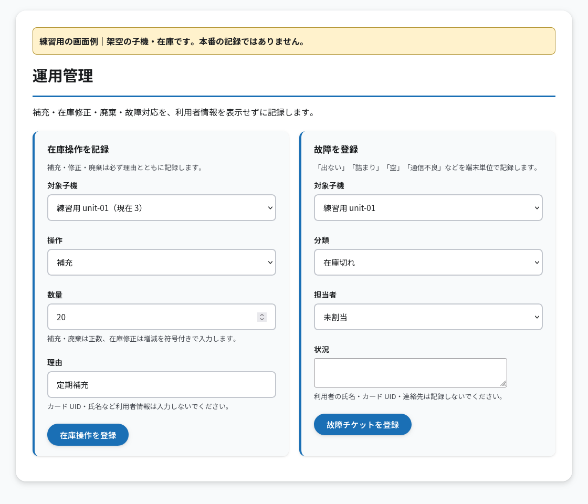
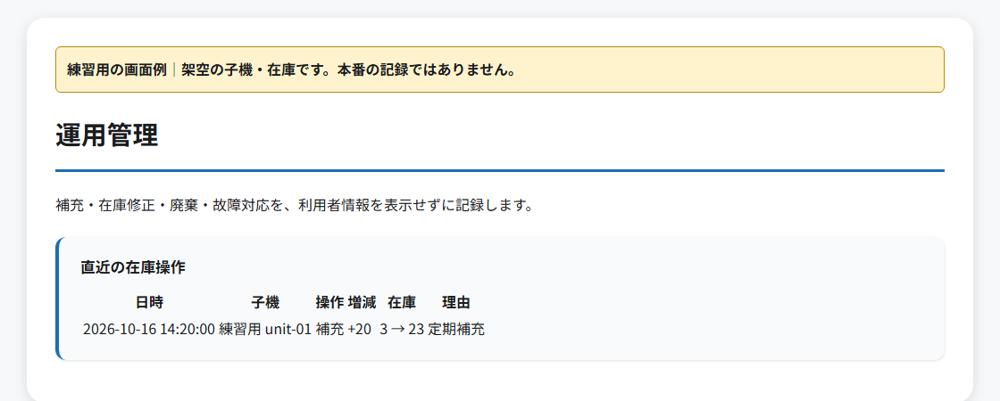

# はじめての OITERU 当番

先輩と一緒に、すでに動いている機械の **在庫を見る → 補充する → 記録する** 練習をします。必要なのはブラウザと、補充する子機です。トイレにある生理用品の受け取り口を「子機」と呼びます。

[初めて引き継ぐ人へ](START_HERE.md) · [困ったとき](#help) · [一人で当番をする前の確認](#一人で当番をする前の確認)

## 0. 先輩と準備する

[引き継ぎ票](docs/handover.md) を開き、次の 4 つを確認します。

- **画面の開き方。** 管理画面のアドレス（URL）と、指定の学内ネットワークや VPN が必要かを確認します。
- **ログイン方法。** 自分のユーザー名と、パスワードの受け取り方を確認します。パスワードは引き継ぎ票やチャットに書きません。
- **担当する子機。** 管理画面に出る子機名、設置場所、補充品の置き場所を確認します。機械の開け方、用品の向きや入れられる数、補充後の戻し方は実物で教わります。
- **相談先。** 困ったときの担当者と連絡方法を確認します。

## 1. 管理画面で「運用管理」を開く

1. ブラウザの上にあるアドレス欄に、教わった URL を入れます。
2. 「管理者ログイン」でユーザー名とパスワードを入力し、**ログイン**を押します。
3. 「管理者ダッシュボード」が開いたら、**運用管理**を押します。

**できた目印**は、「運用管理」の見出しと「在庫操作を記録」の入力欄が見えることです。

## 2. 担当する子機と在庫を見る

1. ページ上部の **補充必須（在庫 0）** で空になっている子機の台数を見ます。子機名は下の **補充必須** 一覧に出ます。
2. **在庫操作を記録**の **対象子機**で、担当の子機名と「現在」の個数を確認します。
3. 現地で同じ名前の機械かを確かめ、実際の在庫を数えます。

画面と実物の数が合わないときや、担当の子機が **heartbeat 超過**（定期連絡が届いていない）や故障チケットに載っているときは、補充する前に先輩と確認します。

## 3. 補充して、追加した個数を入力する

教わった方法で実物を補充します。たとえば **3 個残っている子機に 20 個足した**ときは、「在庫操作を記録」に次のように入れます。

| 画面の欄 | 入力するもの |
| --- | --- |
| 対象子機 | いま補充した子機の名前 |
| 操作 | **補充** |
| 数量 | 足した個数の `20`。補充後の合計は 23 個です |
| 理由 | `定期補充` |

子機名と個数を見直し、**在庫操作を登録**を 1 回押します。

## 4. 履歴を見て、保存できたか確かめる

同じページを下にスクロールし、**直近の在庫操作**を見ます。上の例なら、補充した子機の行に、操作が **補充**、増減が **+20**、在庫が **3 → 23**、理由が **定期補充** と表示されます。

**エラーが出たときや、保存できたか迷ったときも、先に履歴を確認します。** 履歴にあれば保存済みです。見当たらなければ、もう一度押す前に先輩へ相談します。数を間違えて保存したら、先輩と実物を数え直して [在庫修正](docs/operations.md#stock) を記録します。

## 5. 機械を元に戻し、ログアウトする

機械を教わった状態に戻します。「運用管理」のページの一番下で **管理者メニューに戻る** を押し、「管理者ダッシュボード」で **ログアウト** を押します。ログイン画面に戻ったら完了です。

## 困ったとき

| 起きたこと | この順に確かめる |
| --- | --- |
| タッチしても出ない | **在庫 → 画面やランプの表示 → 見える範囲の詰まり**。何度もタッチせず、分解が必要なら担当者へ |
| 子機がオフライン | **電源ランプ → ネットのケーブル → カードリーダーの差し込み**。見える範囲で確認し、配線を触る前に担当者へ。「heartbeat 超過」にあれば最終通信の時刻も控える |
| 管理画面が開かない | **URL → 指定されたネットワークや VPN**。それでも開かなければ、画面の表示を控えて親機の状態を担当者に確認してもらう |
| ログインできない | **ユーザー名 → パスワード → Caps Lock や入力モード**。何度も試す前に先輩へ相談する |
| 用品は出たが記録が見当たらない | **子機名と発生時刻**を控えて担当者へ。再タッチや推測での在庫修正はしない |

### 故障を記録して連絡する

1. 「運用管理」の **故障を登録** で **対象子機** と **分類** を選びます。分類が分からなければ **その他**、担当者が分からなければ **未割当**を選びます。
2. **状況**に、時刻と起きたことを書き、**故障チケットを登録**を押します。故障チケットは対応の進み具合を残す記録です。
3. **対応中・復旧確認の故障チケット**に子機名と **受付** が出たら、番号を控えます。対応する人が「受付 → 対応中 → 復旧確認 → 完了」と更新し、直ったことを確かめたら、何をして直ったかをメモに残します。

担当者には **何をしようとしたか／何をしたか／何が起きたか**を伝えます。子機名、時刻、チケット番号が分かれば添えます。管理画面に入れないときは、分かる内容だけで先に連絡してください。

> 14:20 頃、子機 unit-01。生理用品を受け取ろうと学生証をかざしたところ、モーター音はしましたが用品が出ませんでした。故障チケットは #12 です。

記録や連絡に、利用者の名前・学生証の番号・パスワードは入れません。画面の写真を送るときも、それらを隠します。

## 利用者の操作を体験する

先輩と実物を見るときは、登録用のリーダーに学生証を置き、登録画面（`/register`）で **登録する** を押して結果を待ちます。子機で学生証をかざすと、利用条件を満たしていれば 1 個受け取れます。残り回数は、登録用のリーダーと利用状況の画面（`/usage`）の **利用状況を確認** で見られます。

## 一人で当番をする前の確認

できたことを先輩と [引き継ぎ票](docs/handover.md) に記録します。

- [ ] 管理画面にログインし、画面と現地で担当の子機を確認できた。
- [ ] 補充で足した個数を入力し、「直近の在庫操作」で保存を確認できた。
- [ ] 保存できたか迷ったら、先に履歴を見ることを説明できた。
- [ ] 困ったときに控える内容と、連絡先が分かる。
- [ ] 機械を教わった状態に戻し、ログアウトできた。

故障登録は、練習環境か実際に故障が起きたときに行います。

## 開発・設置・保守の手順

- 自分の PC でテストを動かす。 [開発の第一歩](docs/onboarding.md)
- 新しい親機や子機を設置する。 [初回セットアップ](docs/setup.md)
- 親機が動いているかを確認する。 [親機の運用ガイド](docs/runbook.md)
- 在庫修正、故障対応、バックアップなどを調べる。 [運用・保守の手順](docs/operations.md)
