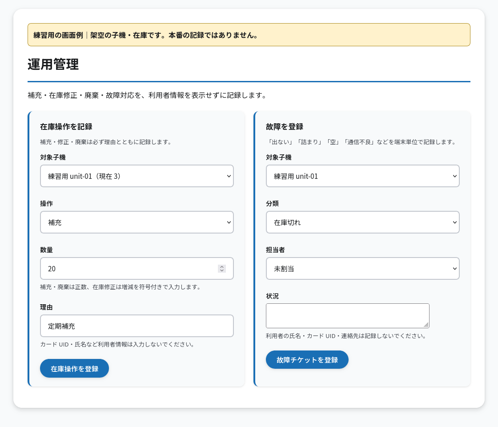
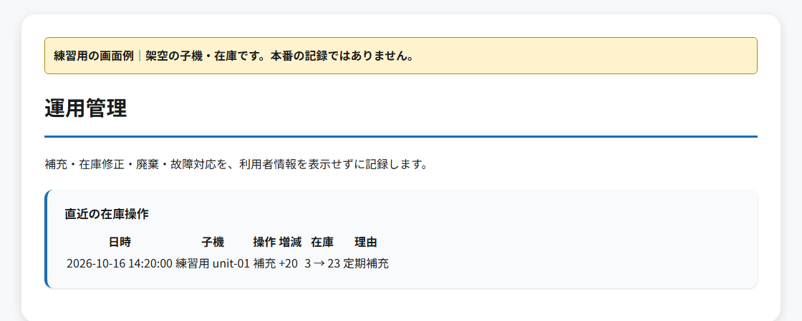

# はじめての OITERU 当番

**今日は「在庫を見る → 補充する → 記録する」ができれば十分です。**
このページは、すでに動いている OITERU を引き継ぐ人向けです。プログラムのインストールやコマンド入力は必要ありません。
初回は先輩と一緒に、次の順番で進めてください。
初めての人は、先に [最初の 1 週間（START_HERE）](START_HERE.md) で全体の流れを確認します。わからない言葉は [用語集](docs/glossary.md) にあります。

| 自分の担当 | 開く説明書 |
| --- | --- |
| 当番・補充をする | このページを上から読む |
| 自分の PC で開発を体験する | [開発の第一歩](docs/onboarding.md) |
| 新しい親機・子機を設置する | [初回セットアップ](docs/setup.md) |
| 親機が止まったので確認する | [親機のかんたん運用ガイド](docs/runbook.md) |

<a id="daily"></a>

## 0. 操作の前に、4 つを一緒に確認する

先輩と [引き継ぎ票](docs/handover.md) を開いて、次の欄を埋めます。

| 必要なもの | 確認すること |
| --- | --- |
| 管理画面の URL | ブラウザのアドレス欄に入れて開ける。必要な学内ネットワークや VPN も教わる |
| ログインする方法 | 自分が使うユーザー名と、パスワードの安全な受け取り方がわかる |
| 担当する機械 | 子機名・設置場所・機械を開けて補充する方法がわかる |
| 困ったときの連絡先 | 誰に、どこで連絡するかがわかる |

**管理画面の URL と問い合わせ先は現在未定です。** 決まり次第、引き継ぎ票に記入します。
空欄があれば先輩と確認してから進めます。パスワードは引き継ぎ票やチャットに書かないでください。
「親機」は記録を管理する PC、「子機」はトイレなどにある受け取り口の機械です。

## 1. 管理画面にログインする

**使うもの：自分の PC のブラウザ。** 初回は PC の広い画面で一緒に確認するのがおすすめです。

1. 教わった管理画面の URL を、ブラウザの上のアドレス欄へ入れる。
2. 「管理者ログイン」でユーザー名とパスワードを入れ、**ログイン**を押す。
3. 「管理者ダッシュボード」が出たら、**運用管理**を押す。

**できた目印：**「運用管理」の見出しと「在庫操作を記録」の入力欄が見えます。
ページが開かない・ログインできない場合は [困ったとき](#help) へ進みます。
ログインの有効期限は標準で 30 分です。作業中にログイン画面へ戻ったら、保存済みか確認してからやり直します。

## 2. 担当する子機を見る

1. 運用管理の **補充必須（在庫 0）** を見る。
2. **heartbeat 超過**と、対応途中の故障チケットを見る。
3. 「在庫操作を記録」の **対象子機**で、担当する子機の名前と現在の数を確認する。
4. 現地で機械の名前と実際の在庫を確認する。

heartbeat は、子機が親機に送る「動いているよ」という定期連絡です。
「heartbeat 超過」に子機名があれば、通信がしばらく届いていません。
故障チケットは「何が起き、誰がどこまで対応したか」を残す記録です。

数がずれているときや故障中の機械は、普段の補充として入力する前に先輩と確認してください。
補充のために機械を止める必要があるかも、初回に実物で教わります。

## 3. 補充して、追加した数を記録する

1. 子機名を確かめてから、教わった方法で実物を補充する。
2. **対象子機**で、その子機を選ぶ。
3. **操作**を **補充** にする。
4. **数量**に、**今回追加した個数**を半角数字で入れる。
5. **理由**に `定期補充` と入れる。
6. 子機名と数量を見直し、**在庫操作を登録**を 1 回押す。

たとえば、もともと 3 個あり、20 個追加した場合の入力は次のとおりです。

| 欄 | 入力するもの |
| --- | --- |
| 対象子機 | 自分が補充した子機 |
| 操作 | 補充 |
| 数量 | `20`（合計の 23 ではありません） |
| 理由 | `定期補充` |



画面例は現在のテンプレートを使い、架空データで作成しています。見やすいようヘッダー等を省略しています。

## 4. 保存できたことを確かめる

1. 同じページを下へスクロールし、**直近の在庫操作**を見る。
2. 今回の **日時・子機名・増減・在庫・理由**を確かめる。
3. 上の例なら、操作が `補充`、増減が `+20`、在庫が `3 → 23`、理由が `定期補充` なら確認できています。



在庫が利用と同時に変わった場合は、先輩と実物・最新の記録を照らし合わせます。

**保存ボタンの後にエラーが出た場合も、先に履歴を確かめます。**
すでに保存されていれば、同じ補充をもう一度登録しません。
数を間違えたときは、元の履歴を消さず、実物を数え直して先輩と在庫修正を記録します。
[修正・廃棄の詳しい入力方法](docs/operations.md#stock) も参照してください。

## 5. 作業を終える

1. 機械を教わった状態へ戻し、補充場所・数量・記録に間違いがないか確認する。
2. 運用管理のページをいちばん下までスクロールし、**管理者メニューに戻る**を押す。
3. 「管理者ダッシュボード」の **ログアウト**を押す。ログイン画面へ戻ることを確認する。

共有 PC ではブラウザを閉じるだけで済ませず、ログアウトします。
ここまでできれば、最初の補充の練習は完了です。

<a id="help"></a>

## 困ったとき：確認して、記録して、連絡する

| 起きたこと | 自分で確認すること | ここで止めて連絡する目安 |
| --- | --- | --- |
| ページが開かない | URL の打ち間違い、指定の学内ネットワーク・VPN | 接続しても開かない。エラー画面の内容を控える |
| ログインできない | ユーザー名、Caps Lock、全角・半角 | わからなければ連続で試さない。標準で 5 回失敗すると約 15 分制限される |
| 子機がオフライン | 電源ランプ、ケーブルが抜けていないか、運用管理の「heartbeat 超過」に出る最終通信 | 勝手に配線・設定を変えず、子機名と状態を伝える |
| タッチしても出ない | 在庫、画面や LED の表示、見える範囲の詰まり | 分解せず、連続タッチをやめ、故障チケットを作る |
| 出たのに記録が増えない | 何時に、どの子機で起きたか | 再タッチ・再起動・推測での在庫修正をせず、担当者へ連絡する |
| 記録が保存されたかわからない | 再読込して「直近の在庫操作」を見る | 記録が確認できなければ、同じ入力を繰り返す前に相談する |

### 故障チケットを残す

1. 運用管理の **故障を登録**で、対象子機・分類・状況を入れる。
2. 分類に迷ったら **その他**、担当者がわからなければ **未割当**にする。
3. **故障チケットを登録**を 1 回押し、「対応中・復旧確認の故障チケット」に `#番号 子機名` と `分類 / 受付` が出ることを確かめる。
4. 引き継ぎ票の連絡先へ、下のメモを送る。

例：`14:20 頃、unit-01。タッチするとモーター音はするが、用品が出てこない。`
対応する人が「受付 → 対応中 → 復旧確認 → 完了」と更新します。
自分がまだ復旧を確認していなければ、完了にしません。

```text
しようとしていたこと：
行った操作：
起きたこと・画面の表示：
子機名・発生時刻：
故障チケットの番号（わかれば）：
```

記録・連絡に、使った人の名前、カード番号、パスワードは入れません。
画面写真を添える場合も、それらを隠してください。管理画面自体に入れない場合は、先にメモで連絡します。

## 利用者の操作も、先輩と 1 回体験する

| したいこと | 使う場所 | 操作 |
| --- | --- | --- |
| 最初にカードを登録する | 登録用の親機 PC と、その USB リーダー | `/register` を開き、カードを置いて **登録する**。結果が出るまで置いたまま待つ |
| 生理用品を受け取る | 設置された子機 | カードをかざし、表示に従って排出が終わるまで待つ |
| 自分の残り回数を見る | 登録用の親機 PC と、その USB リーダー | `/usage` を開き、カードを置いて **利用状況を確認** |

登録・利用状況の画面に管理者ログインは不要です。
**スマートフォンで画面を開くだけでは、手元のカードは読めません。** 読むのは親機につないだリーダーです。
利用できない場合は、管理者が登録・利用許可・残り回数・利用上限・子機在庫を確認します。

## 一人で当番をする前の確認

先輩に見てもらいながら、次を実際にできたら引き継ぎ票へ記録します。

- [ ] 教わった URL を開き、自分でログインできた。
- [ ] 担当する子機を、画面と現地の両方で確認できた。
- [ ] 「追加した数」を入力し、保存後の履歴を確認できた。
- [ ] 保存できたか不明な場合、履歴を見てから判断することを説明できた。
- [ ] 異常時に控えることと、連絡先を説明できた。
- [ ] ログアウトできた。

故障登録の練習は、先輩が用意した練習環境か、本当に発生した事象で行います。
練習だけの故障や補充を、本番の記録へ追加しないでください。

<a id="development"></a>
<a id="setup"></a>
<a id="setup-parent"></a>
<a id="setup-unit"></a>
<a id="maintenance"></a>

## 開発・設置・保守の説明書

| 作業 | 読む場所 |
| --- | --- |
| Git・Python の準備、初めてのテスト、翌日の再開 | [開発の第一歩](docs/onboarding.md) |
| 親機・子機の初回導入 | [初回セットアップ](docs/setup.md) |
| 親機を確認・復旧する | [親機の運用ガイド](docs/runbook.md) |
| 在庫修正、故障対応、バックアップ、オフライン時の動作 | [運用・保守の手順](docs/operations.md) |
| 設定値の意味を調べる | [設定ファイルの説明](docs/configuration.md) |
